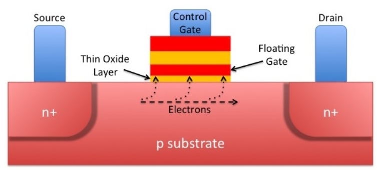
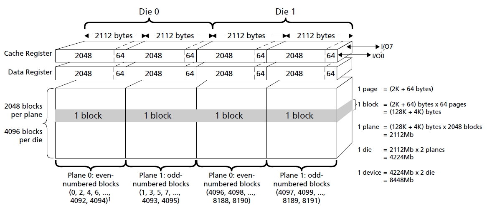
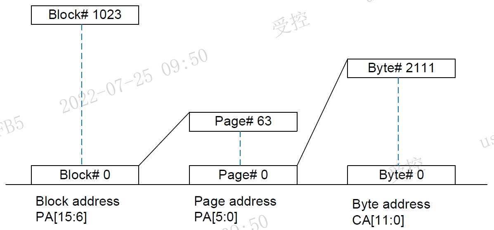
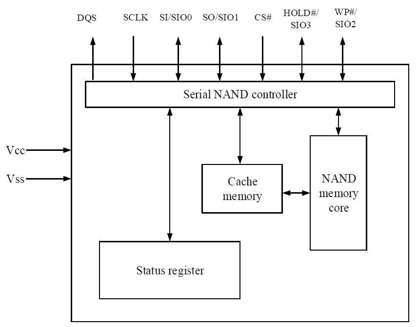

# Physical Characteristics

This section outlines the physical characteristics of NAND flash memory, covering its fundamental storage cell principles, hierarchical array organization, and internal hardware block components.

## Physical Structure

The internal storage unit of flash memory is based on a MOSFET containing a floating gate, which serves as the actual unit for storing data. Long before flash memory, ultraviolet-erasable EPROM already utilized this floating gate storage technology. 

Data is stored inside flash memory cells in the form of electrical charge. The amount of stored charge depends on the voltage applied to the external control gate, which controls whether electrons are injected into or released from the floating gate. Data representation is determined by whether the stored charge's threshold voltage (Vth) exceeds a specific threshold, giving a flash memory cell a default state of `1`.

* **Program (Writing)**: The process of controlling the control gate to charge (by applying voltage to the control gate) so that the floating gate traps enough charge to exceed the threshold voltage Vth, which represents a logical `0`.
* **Erase**: The process of discharging the floating gate to bring its voltage below the threshold voltage Vth, which represents a logical `1`.

## Storage Organization

The hierarchical structure of NAND flash typically follows: `Nand` → `Chip/Die` → `Plane` → `Block` → `Page + OOB`. 

* **Chip / Die**: Each NAND device contains one or more chips. A chip is the smallest unit that can independently execute commands and report status.
* **Plane**: Independent parallel processing sub-arrays inside flash memory. Each chip contains multiple planes that can support concurrent or interleaved operations to increase throughput.
* **Block**: The largest local architectural organization and the minimum unit for erasure operations (erasing resets the block to an all-0xFF state, failure to erase marks it as a bad block). This consists of multiple pages (e.g., up to 512KB in NAND).
* **Page**: The smallest discrete unit for program and read operations. This is the basic grid allocation where data can be written or loaded into the internal data buffer or cache. Common hardware page boundaries range from 2KB to 4KB in advanced NAND flash.
* **Out-of-Band (OOB) or Spare Area**: Also known as the idle area or redundant area, it is a dedicated metadata storage region physically associated with every page in a NAND flash array. It typically provides 16 to 128 bytes per page for system-level information, such as ECC syndrome bits, logical-to-physical block mapping, and factory-set bad block markers (BBMs). This region is accessed by extending the column address beyond the main page boundary.
* **Data Buffer or Page Buffer / Cache**: Volatile SRAM cache residing directly on the flash chip. This is the static memory workbench physically located on the external storage silicon. It temporarily buffers page-sized data during random load programs or page reads before data is committed to the physical floating-gate cells.

* **Row Address or Page Address**: The high-level addressing component used to select a specific block and page within the memory array. In NAND architecture, the row address initiates the internal hardware process of sensing and transferring a complete page of data from the storage cells into the data buffer.
* **Column Address**: The low-level addressing component used to determine the specific byte or word offset within a selected page. It functions as a pointer within the data buffer, allowing the controller to perform partial reads or write updates to specific locations of the page currently residing in the cache.

## Block Diagram

Based on the hardware block diagram, a serial NAND flash device integrates several key internal functional blocks to manage command execution, data buffering, and error checking.

* **NAND Flash Array**: Characterized by series cell connections. It trades off random access capabilities for massive storage density. It cannot perform byte-addressable reads or support XIP, instead, it operates strictly as a page-addressable block device, requiring data to be copied into RAM before execution.
* **Serial NAND Controller**: Manages internal command dispatch, serial bus communications (CLK, CS#, SIO0-SIO3), and coordinates data transfer between the host interface and internal memory arrays.
* **ECC and Status Register**: Hardware logic dedicated to error detection/correction and status monitoring, ensuring data reliability and operational state tracking.
